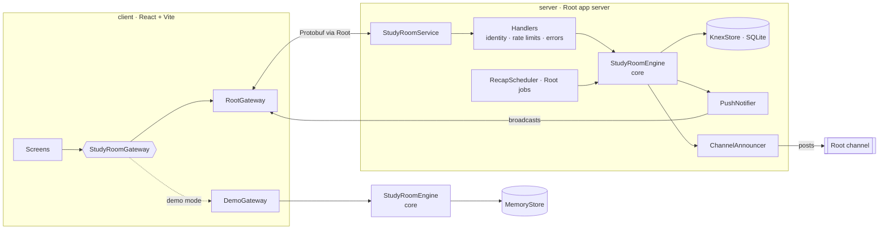

# Study Squad: Group Study Timer

**Focus together. See who's working, start a timer, keep your streak.**

Study Squad is a group study timer for [Root](https://www.rootapp.com) communities: a pomodoro-style focus timer you study together with, like a quiet library where you can see everyone else working. Join the room's shared timer, put a goal on the board, and when the round ends every screen celebrates and flips to break at the same moment.


<p>
  
  
  
</p>

## Features (v0.1)

- **Shared room timer** (25/5 or 50/10, rounds of 4 with a long break) and **solo timers** that still show on the board
- **Live focus board**: who's focusing, on what, and how long is left. Goals can be private ("Focusing")
- **No drift**: the server stores when a cycle started; every client derives the countdown from that and a measured clock offset
- **Break moment**: XP earned, streak, damage dealt to the boss, and "did you finish your goal?"
- **Game layer**: XP and levels (daily cap), a combo multiplier for focusing together, a weekly community boss
- **Streaks without guilt**: one finished session counts the day, one free freeze per week
- **Channel posts**: daily recap, "room is busy", streak milestone posts, and a squad bot with six personalities that cheers on (and mentions) the people studying
- **Admin settings** through Root's Global Settings (no custom admin UI to secure)

See [DESIGN.md](DESIGN.md) for the reasoning behind each rule and [docs/API.md](docs/API.md) for the client/server contract.

## Try it without a Root account

The demo mode runs the real engine in your browser with a few simulated members:

```bash
npm install
```

```bash
npm run generate
```

```bash
npm run demo
```

Open the printed URL. Add `?focus=0.2&break=0.2` to make rounds 12 seconds long and see the break moment quickly.

More URL settings for testing (boss nearly beaten, a long streak, replaying badge unlocks) are in [docs/TESTING.md](docs/TESTING.md). Merges to `main` deploy to Root on their own: see [docs/DEPLOYING.md](docs/DEPLOYING.md).

## Run it inside Root

1. Sign up at the [Root Developer Portal](https://dev.rootapp.com) and create an app. Its id is already in `root-manifest.json` (`"id"`). Use your own app id if you fork this.
2. Copy `.env.example` to `server/.env` and paste your dev token. Never commit it.
3. Start the server through Root's dev host, then the client:

```bash
npm run build
```

```bash
npm run server
```

```bash
npm run client
```

Requests route through Root's servers, so a valid `DEV_TOKEN` is required even locally.

## Scripts

| Command                 | What it does                                                          |
| ----------------------- | --------------------------------------------------------------------- |
| `npm run generate`      | Generates client/server networking code from `networking/src/*.proto` |
| `npm run verify`        | Format check, lint, typecheck, all unit and integration tests, build  |
| `npm test`              | Vitest across `core`, `contract`, `server`, `client`                  |
| `npm run test:coverage` | Same, with a coverage report in `coverage/`                           |
| `npm run test:e2e`      | Playwright against the demo build, desktop and phone profiles         |
| `npm run demo`          | Client with the in-browser engine and simulated members               |
| `npm run server`        | Server through Root's dev host (needs `server/.env`)                  |
| `npm run client`        | Client dev server for use inside Root                                 |

## Architecture



| Workspace     | Purpose                                                                                                                    |
| ------------- | -------------------------------------------------------------------------------------------------------------------------- |
| `core/`       | Pure TypeScript domain: timer math, XP, streaks, boss, settings, and the `StudyRoomEngine` use cases behind ports. No I/O. |
| `networking/` | Protobuf contract. `rootsdk build proto` generates `networking/gen/{client,server,shared}`.                                |
| `contract/`   | Maps engine DTOs to the generated messages and back. One place, round-trip tested.                                         |
| `server/`     | Root adapters: SQLite store, request handlers, broadcasts, channel posts, recap job.                                       |
| `client/`     | React UI. Talks to a `StudyRoomGateway`, implemented for Root and for the in-browser demo.                                 |

The layout follows Root's official `@rootsdk/create-root` template, with `core` and `contract` added so the rules can be tested without Root.

## Testing

- **core**: unit tests for every rule, plus engine scenarios with a fake clock (shared countdown, late joiners, downtime recovery, rollback on failure, caps, posts)
- **contract**: DTO → Protobuf → bytes → Protobuf → DTO round trips
- **server**: one `Store` contract suite run against both the in-memory store and SQLite; an integration test that fans broadcasts out to several clients through the wire format and checks they see the same timer and the same break; handler tests for identity, rate limits and error hygiene
- **client**: reducer and view helpers, and app tests that drive the real UI on the real engine
- **e2e**: Playwright on desktop and phone viewports, failing on any console error

## Design

The original mockups live in [docs/design](docs/design). Implementation choices that differ from them are listed in [DESIGN.md](DESIGN.md#where-the-app-differs-from-the-mockups).

## Contributing and security

See [PRIVACY.md](PRIVACY.md) for what the app stores and how members delete it, [CONTRIBUTING.md](CONTRIBUTING.md) for the branch workflow and checks, [SECURITY.md](SECURITY.md) for how to report a vulnerability, and [CHANGELOG.md](CHANGELOG.md) for release notes.

## License

[MIT](LICENSE). Fonts in `client/src/assets/fonts` are under the SIL Open Font License (see `OFL.txt` there). The Root SDK packages are © Root Communications, Inc. and are installed from npm, not redistributed here.
